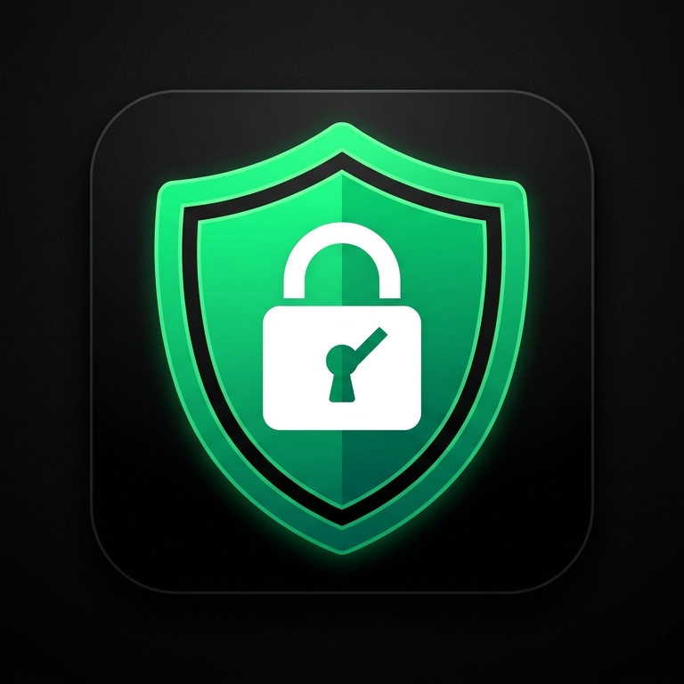

# DNS Shield

DNS Shield 讓你決定要攔哪些網域、查詢交給誰解析。用內建合併清單與自訂規則封鎖常見廣告、追蹤和惡意網域，解析器也能自行選擇。Android 7.0（API 24）以上可用，不需 Root。

## v1.5.0 的改進與 DNS 選擇

內建封鎖清單從 102,241 筆增加到 247,497 筆。DNS Shield 會先用內建清單和你的規則判斷要不要封鎖，再把放行的查詢交給解析器。改用系統 DNS 或 Cloudflare，這層本機封鎖照常運作。想保留 AdGuard 解析服務本身的額外過濾，可以繼續選「AdGuard (AdBlock)」。

Android 10 以上可選「系統 DNS」，跟著目前連上的 Wi-Fi 或行動網路解析。查詢是否加密，由 Android 的「私人 DNS」設定決定。想固定使用 Cloudflare 的加密 DNS，可以選「Cloudflare DNS」，再開啟「僅加密」。

在同一支 ASUS 上連同一個 Wi-Fi，開啟相同的 App 和頁面。每輪收滿 128 筆後，系統 DNS 的 P95 最高分別是 60 和 86 ms，Cloudflare DoH 那輪最高是 133 ms。想知道哪個選項適合你的網路，可以用同樣的 App，比較「連線診斷」的最近 128 筆 P95 和失敗數。

剛開機時，如果 Wi-Fi 或行動網路還沒就緒，系統 DNS 會讓還沒送出的查詢在原本的期限內等網路連上，減少開機初期的解析失敗。原地升級會沿用你選的解析器。測試條件與完整結果見 [v1.5.0 發布說明](https://github.com/XiangWang2000/dns-shield/releases/tag/v1.5.0)。

## 你可以決定

- **擋哪些網域：** 使用 APK 內附的 1Hosts Lite 與 AdGuard DNS Filter 合併清單，也可新增精確或包含子網域的允許／封鎖規則；規則保存在裝置。名單隨 APK 更新，App 執行時不會另行下載。
- **交給誰解析：** 選擇 Google、Cloudflare、AdGuard、Quad9，或自訂 IPv4／IPv6 DNS 位址與 DoH 端點；DoH bootstrap 支援 IPv4 與 IPv6。
- **加密失敗怎麼辦：** 預設加密優先，DoH 故障時可降級為明文 UDP/53；選「僅加密」則故障時回報解析錯誤，不送出明文 DNS。
- **App 例外與記錄：** 排除指定 App；同網域記錄合併顯示最新判斷與累計記錄次數，可搜尋、篩選及複製完整網域。

## 安裝與啟動

1. 從 [GitHub Releases](https://github.com/XiangWang2000/dns-shield/releases) 下載並安裝 APK。
2. 開啟 DNS Shield，選擇解析器；使用其他解析器時可再設定加密模式。
3. 啟用防護，同意 Android VPN 權限，確認 App 顯示已啟用與系統 VPN 指示。

> 本頁依目前原始碼介紹功能；已發布 APK 可能尚未包含所有新功能，請以 [GitHub Releases](https://github.com/XiangWang2000/dns-shield/releases) 的版本說明為準。直接升級需使用相同簽名的 APK。

## 隱私

DNS Shield 沒有帳號、分析或廣告 SDK，也沒有開發者後端。DNS 設定、網域規則與 App 排除名單留在裝置；未被封鎖的查詢會送到你選擇的解析器，或在選用「系統 DNS」時交給 Android 目前網路的系統解析器。資料保存方式依該解析器政策。

DoH 透過 HTTPS 傳輸；降級至 UDP/53 時，查詢未加密。DNS Shield 不在本機驗證 DNSSEC。查詢計數與即時日誌主要保存在 App 記憶體。詳見[隱私權說明](PRIVACY.md)。

## 防護範圍與限制

本機 VPN 只攔截送往虛擬 IPv4／IPv6 DNS 位址的 UDP／TCP 53 查詢。一般 IPv4／IPv6 流量仍走原本網路；App 直接送往其他外部 DNS 位址的查詢、App 自帶的 DoH／DoT 與直接 IP 連線不會被攔截。在沒有 464XLAT 的 IPv6-only 網路，所選解析器須可經 IPv6 連線。若網路靠 DNS64／NAT64 連到只有 IPv4 的服務，DNS64 由所選解析器提供，NAT64 由底層網路提供。同一網域若同時提供廣告與正常內容，也無法只封鎖廣告。

若要在重開機後恢復防護，請在 Android 的 VPN 設定點選 DNS Shield 旁的齒輪，開啟「永久連線的 VPN」。Android 10 會在開機後首次解鎖時啟動。部分手機的電池管理可能阻止背景恢復，已測的 ASUS Android 10 裝置使用了電池豁免。目前不支援封鎖未經 VPN 的連線（lockdown）。

## 開發

開發環境、架構與指令見[開發指南](docs/development.md)；規格、benchmark 與歷史驗證從[文件索引](docs/README.md)查找。版本異動見[CHANGELOG.md](CHANGELOG.md)，第三方資料與授權見[THIRD_PARTY_NOTICES.md](THIRD_PARTY_NOTICES.md)。

## 授權

Copyright 2026 XiangWang2000

DNS Shield is licensed under the [Apache License 2.0](LICENSE).
